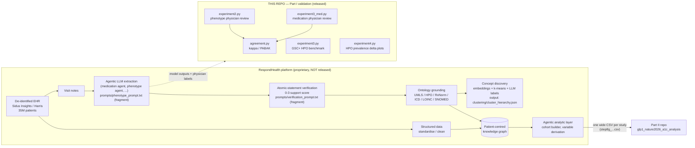
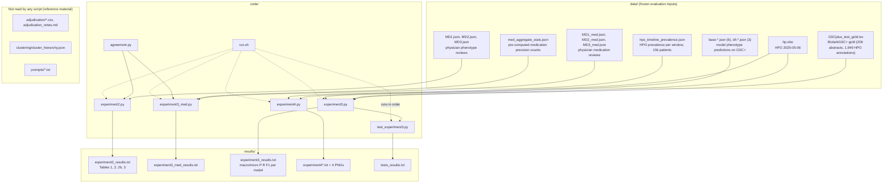

# Architecture — Part I (extraction validation)

This repository is **Part I** of the code behind *Computable longitudinal patient journeys from
structured and unstructured EHR data* (Kim, Foty et al., *Nature Medicine* 2026,
doi:10.1038/s41591-026-04695-x). It contains the **evaluation** of the authors' LLM extraction
platform, not the platform itself. Part II (the GLP-1 outcome analysis) is the sibling repository
`glp1_nature2026_a1c_analysis`.

## 1. Where this repo sits in the paper's system

The paper describes a five-layer platform. Only the shaded layer is released here; the rest is
proprietary (see the Code availability statement) or lives in Part II.

## 2. Inside this repo

Everything is batch: `code/run.sh` runs the unit tests and four experiment scripts, each reading
frozen inputs under `data/` and writing a text log or PNG under `results/`. There is no shared
Python package other than `code/agreement.py`; each experiment is a standalone script with
hard-coded relative paths (`os.path.join(script_dir, '..', 'data')`).

### Execution order (`code/run.sh`)

| Step | Command | Output | Paper item |
|---|---|---|---|
| 1 | `python3 -m unittest discover -s . -p 'test_*.py'` | `results/tests_results.txt` | — |
| 2 | `python3 experiment2.py` | `results/experiment2_results.txt` | Table 1 (phenotype rows), Extended Data Table 1 (phenotype κ) |
| 3 | `python3 experiment3_med.py` | `results/experiment3_med_results.txt` | Table 1 (medication rows), Extended Data Table 1 (medication κ) |
| 4 | `python3 experiment3.py` | `results/experiment3_results.txt` | Extended Data Table 5 (BiolarkGSC+) |
| 5 | `python3 experiment4.py --json ... --data_dir ../data --output_dir ../results` | `results/experiment4_results.txt`, two PNGs | Exploratory phenotype-prevalence figure (not a numbered display item) |
| 6 | same with `--no-normalize --suffix experiment4_unnormalized` | sensitivity figures | — |

`run.sh` uses `set -euo pipefail`, records each step's exit code, echoes the last 20 lines of a
failing log to stderr, keeps running the remaining steps, and exits non-zero at the end if any
step failed.

## 3. Design properties worth knowing

- **Reproducible offline.** No network, no model calls, no PHI. All LLM outputs were generated
  upstream and are frozen in `data/`. Running `run.sh` reproduces every number in `results/`.
- **Scoring is independent of ontology assignment.** In `experiment3.py` the gold HPO ID drives
  synonym and hierarchy expansion; the model's own `hpo_matched_name` is only an extra surface
  string. Extraction quality and normalisation quality are therefore separately measurable.
- **One agreement estimator.** `agreement.py` is the only kappa implementation. It reports Cohen's
  κ and PABAK side by side with p_o and p_e and flags degenerate pairs, so the medication table's
  κ = 0.000 at 95.8 % agreement is explained rather than hidden.
- **Minimal dependencies.** Only `experiment4.py` needs third-party packages (`numpy`,
  `matplotlib`). The other three experiments and the tests are standard-library Python.
- **No configuration layer.** Paths, model lists, reviewer file names, source keys, and display
  names are literals inside each script. See `REUSE_GUIDE.md` for the exact edit points.

See `CODE_REFERENCE.md` for function-level documentation, `DATA_SCHEMA.md` for every input and
output format, `PAPER_COVERAGE.md` for what the paper reports that is and is not reproducible
here, and `REUSE_GUIDE.md` for how to run the same validation on another clinical question or on
MIMIC.
